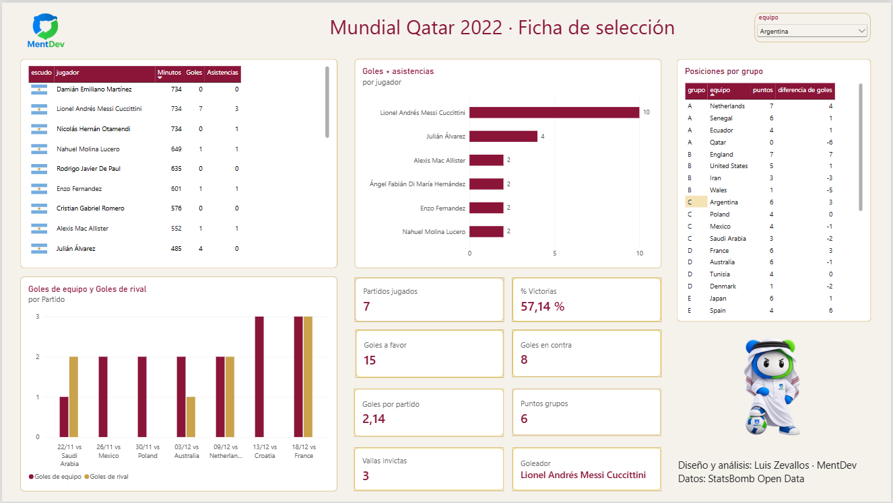
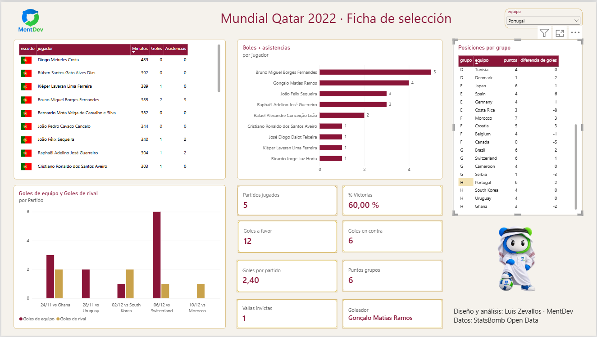
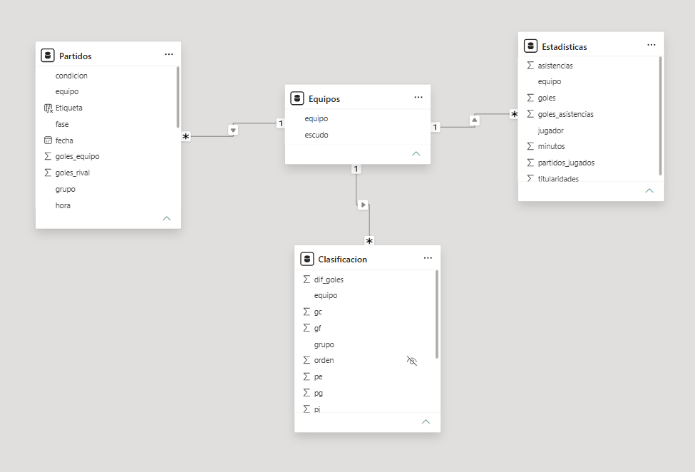

# Mundial Qatar 2022 · Ficha de selección

Dashboard interactivo en Power BI para explorar el desempeño de cada selección del Mundial de Qatar 2022: resultados partido a partido, rendimiento de los jugadores y posiciones de la fase de grupos. Los datos se obtienen de **StatsBomb Open Data** y se procesan con un script de Python que genera el Excel que alimenta el modelo.



Al elegir un equipo en el segmentador, se actualizan las tarjetas, el gráfico de goles por partido y las tablas de jugadores.



## Qué responde el dashboard

- ¿Cómo le fue a cada selección partido a partido (goles a favor y en contra)?
- ¿Quiénes fueron los jugadores más determinantes (minutos, goles, asistencias y goles + asistencias)?
- ¿Cómo quedó cada grupo de la fase inicial?
- ¿Qué tan efectivo fue cada equipo (% de victorias, goles por partido, vallas invictas)?

## Flujo de trabajo

```
StatsBomb Open Data (JSON)  →  Python (pandas)  →  mundial2022.xlsx  →  Power Query  →  Modelo + DAX  →  Dashboard
```

1. **Extracción y transformación (Python)**: el script descarga los JSON de partidos, alineaciones y eventos (con caché local), aplana los datos anidados y genera 4 tablas: `Equipos`, `Partidos`, `Estadisticas` y `Clasificacion`.
2. **Carga y limpieza (Power Query)**: tipos de datos y columna `orden` para ordenar la tabla de posiciones por grupo.
3. **Modelado**: `Equipos` como tabla de dimensión que se relaciona con `Partidos`, `Estadisticas` y `Clasificacion`.
4. **Medidas (DAX)**: indicadores de las tarjetas, etiqueta de partidos y posición dentro del grupo.
5. **Visualización**: diseño propio con identidad MentDev.



## Tecnologías

Power BI (Power Query y DAX) · Python (pandas, requests, openpyxl) · Excel · StatsBomb Open Data

## Estructura del repositorio

```
├── capturas/     Imágenes del dashboard y del modelo de datos
├── codigo/       Script de Python, medidas DAX y paso de Power Query
├── datos/        mundial2022.xlsx generado por el script
├── powerbi/      Archivo .pbix
└── README.md
```

## Cómo reproducirlo

1. Instala las dependencias: `pip install pandas requests openpyxl`
2. Ejecuta `python codigo/etl_statsbomb.py`. Se genera `mundial2022.xlsx` con las 4 tablas formateadas como tablas de Excel.
3. Abre `powerbi/dashboardMundial2022.pbix` en Power BI Desktop.
4. Si Power BI muestra un error al actualizar, la ruta del Excel está guardada para mi equipo. Cámbiala en **Inicio → Transformar datos → Configuración de origen de datos → Cambiar origen** y apúntala al `mundial2022.xlsx` de la carpeta `datos/`.

Para usar otra competición (por ejemplo la Copa América 2024), cambia `COMPETITION_ID` y `SEASON_ID` al inicio del script. Los identificadores están en `data/competitions.json` del repositorio de StatsBomb.

## Criterios y decisiones

- **Penales**: la tanda de penales no cuenta como tiempo de juego ni como goles. Un partido que termina empatado en el tiempo reglamentario o en la prórroga cuenta como **empate**, aunque se defina por penales. Por eso Argentina, campeón del mundo, aparece con 57,14 % de victorias (4 de 7 partidos): el 2-2 ante Países Bajos y el 3-3 ante Francia se cuentan como empates.
- **Tabla de grupos**: se ordena por puntos, diferencia de goles y goles a favor. Es un criterio simplificado: la FIFA también considera el resultado entre los equipos empatados.
- **Grupos vacíos en la fuente**: en algunos partidos StatsBomb deja el grupo en blanco (por ejemplo, Marruecos-Croacia). El script lo corrige con un diccionario equipo → grupo construido con los datos que sí vienen.
- **Nombres de equipos**: se mantienen en inglés, tal como vienen de la fuente. Los escudos se reemplazan por banderas obtenidas por código ISO del país.

## Medidas DAX principales

| Medida | Qué calcula |
|---|---|
| `Partidos jugados` | Partidos distintos del equipo seleccionado |
| `% Victorias` | Victorias entre partidos jugados |
| `Goles por partido` | Goles a favor entre partidos jugados |
| `Vallas invictas` | Partidos en los que el rival no marcó |
| `Puntos grupos` | 3 por victoria y 1 por empate en fase de grupos |
| `Goleador` | Jugador con más goles del equipo |

El código completo, con las columnas calculadas `Etiqueta` y `Pos.`, está en [`codigo/medidas-dax.md`](codigo/medidas-dax.md). El paso de Power Query que crea la columna `orden` está en [`codigo/power-query-clasificacion.md`](codigo/power-query-clasificacion.md).

## Qué se puede ver en el dashboard

- **Argentina**: 7 partidos, 15 goles a favor y 8 en contra, con 3 vallas invictas. Messi marcó 7 goles y dio 3 asistencias (10 participaciones), seguido de Julián Álvarez con 4.
- **Portugal**: su mayor resultado fue el 6-1 sobre Suiza; terminó con 60 % de victorias, 12 goles a favor y 6 en contra.
- **Fase de grupos**: Países Bajos e Inglaterra sumaron 7 puntos; Inglaterra tuvo la mayor diferencia de goles de su grupo (+7). Qatar cerró con 0 puntos y diferencia de -6.

## Próximos pasos

- Versión 2: métricas de calidad de las ocasiones (xG) y una segunda página con las fases eliminatorias.
- Adaptar el mismo flujo a la Copa América 2024.

## Créditos

- Datos: [StatsBomb Open Data](https://github.com/statsbomb/open-data). Consulta sus términos de uso y atribución en su repositorio.
- Banderas: [Flagcdn](https://flagcdn.com).
- Diseño y análisis: **Luis Zevallos · MentDev**. La mascota Devi es un personaje propio de MentDev.

Proyecto independiente con fines de aprendizaje y portafolio, sin vinculación con la FIFA ni con ninguna federación.
